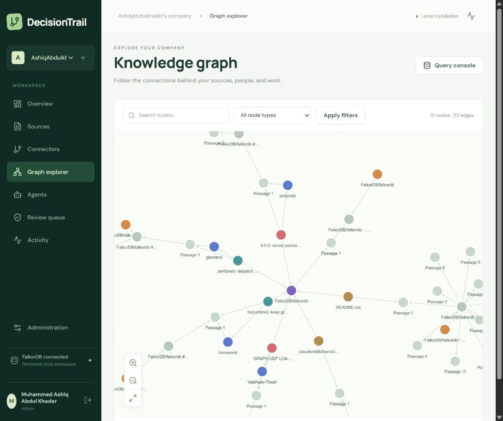

# DecisionTrail

A local company intelligence workspace. Ingest real documents and structured records, connect GitHub through a GitHub App, explore the actual FalkorDB graph, and run agents that return sources and relationship paths.



## Run locally (Windows / PowerShell)

Requires Docker Desktop, Python 3.11+, and Node.js 22+. GitHub CLI is optional for local sign-in. The repository's current environment is `.venv` with Python 3.11.

```powershell
py -3.11 -m venv .venv
.\.venv\Scripts\python.exe -m pip install -r requirements.txt
Copy-Item .env.example .env
docker compose up -d
Set-Location frontend
npm ci
npm run build
Set-Location ..
.\.venv\Scripts\python.exe -m uvicorn app.main:app --host 127.0.0.1 --port 8765
```

Open [DecisionTrail](http://127.0.0.1:8765). Create the installation's owner account, or use **Continue with GitHub CLI** after `gh auth login --hostname github.com`. Each account has an isolated workspace. No synthetic company is loaded into the product.

The source tree also contains the original Atlas regression fixture and its API. Use **`app.main:app`**, not `app.api:app`, for the product.

## Configure the GitHub App

1. Sign into DecisionTrail as the administrator.
2. Open **Administration → GitHub App → Register on GitHub**.
3. Review and create the private app in GitHub. The backend exchanges the manifest code and stores the App ID and private key encrypted locally.
4. Select the repositories you want to grant, review the read-only permissions, and install.
5. GitHub returns to DecisionTrail. Open **Connectors → Browse repositories**, choose an allowed repository, select data categories, and start sync.

Permissions: metadata, contents, issues, and pull requests — all read-only. Installation tokens are obtained on demand and expire after an hour; they are not stored. The local GitHub CLI credential is used only to verify local sign-in identity, not as the repository connector token.

For an existing app, enter its App ID, slug and RSA PEM private key in Administration. Its **Setup URL** is:

```text
http://127.0.0.1:8765/api/connectors/github/app/setup
```

The manifest flow omits webhooks for local operation. Manual re-sync is available; automatic sync/webhooks are pending. The install button starts a session-bound flow, so use it rather than opening a setup callback manually.

## Ingest your data

Upload or drop supported files in **Sources**, or choose **Paste text**. Supported formats are Markdown, plain text, CSV, JSON, PDF, DOCX, RST, logs and YAML. PDFs must contain readable text; OCR is not included.

- Documents are stored as versioned passages with source provenance.
- CSV rows and JSON records become typed graph records. Matching record IDs can form reference relationships.
- JSON graph imports support explicit entities and custom relationships:

```json
{
  "nodes": [
    {"id": "project-orbit", "name": "Orbit", "type": "Project"},
    {"id": "person-jules", "name": "Jules", "type": "Person"}
  ],
  "edges": [
    {"source": "person-jules", "target": "project-orbit", "type": "OWNS"}
  ]
}
```

Re-upload the same filename to update that source. Identical content does not create a duplicate version. The source inspector displays the raw text, metadata, history, text editing, archive, and optional AI enrichment. Archive keeps evidence history but removes the source from current retrieval.

Explicit processing limits: 10 MB/upload, 500,000 extracted characters, 300 PDF pages, 2,000 structured rows/nodes and 4,000 declared edges. GitHub imports have a configurable 1–100 item/category limit and report when that limit is reached.

## Agents and free models

Set `OPENROUTER_API_KEY` in the gitignored `.env`, or enter a key in Administration. Never put it in source code. `OPENROUTER_MODEL` must be `openrouter/free` or a model ID ending `:free`; paid IDs are rejected. Free availability and rate limits vary.

The agent workbench supports editable definitions, graph-tool planning, current passage search, entity discovery, relationship expansion and source history. Answers include source passages and a tool trace. Every run is saved. The UI labels model failures/fallbacks; graph evidence remains usable without a model.

AI enrichment is opt-in and sends source passages to the configured free OpenRouter model. It validates entity/relation JSON and accepts a relationship only when its quoted evidence is an exact substring of the source. Default budget is 6 passages per request (API maximum 30); Activity reports partial coverage and failures.

Agents can propose source-backed review tasks. Approval creates a Task node linked to its source in the company graph and records the review. No GitHub issue, comment, or repository write is performed by this workflow.

## Explore and query

Graph explorer supports real node/edge rendering, filtering, pagination, neighbor expansion, pan/zoom and a property inspector. The Cypher console uses FalkorDB's read-only command and can render returned nodes/relationships as a subgraph.

```cypher
MATCH (person:Person)<-[r:RELATED_TO]-(item:Entity)
RETURN person, r, item
LIMIT 30
```

```cypher
MATCH (doc:Document)-[:HAS_VERSION]->(version:DocumentVersion {active: true})
      -[:HAS_CHUNK]->(chunk:Chunk)
RETURN doc.name, chunk.position, chunk.text
LIMIT 10
```

Queries time out after 2 seconds, and API responses cap results. This is an interactive explorer, not an unlimited export endpoint.

## Verification

```powershell
.\.venv\Scripts\python.exe -m pytest -q
Set-Location frontend
npm run build
```

Tests use real isolated FalkorDB graphs and LangChain fake models. They cover uploads, content versions, graph query write rejection, workspace isolation, key redaction, agent planning, citations, reviewed task persistence, GitHub App state/JWT/token behavior, and the original temporal regression fixture.

Live verification on October 17, 2026: a GitHub App was created and installed; a public `FalkorDB/falkordb` import produced 7 sources, 51 nodes and 53 relationships before optional enrichment. A real query returned author relations, and an OpenRouter free-model agent run returned 8 evidence passages with a connected model status. A recorded demo video and hosted deployment remain pending.

Optional live smoke script (imports a bounded public repository into the signed-in CLI owner's workspace):

```powershell
.\.venv\Scripts\python.exe scripts\verify_live.py --repository FalkorDB/falkordb
```

## Persistence and deployment

`.data/` holds the SQLite control database, encrypted credentials, local encryption key, and uploads. Back up this directory privately. Docker Compose uses a persistent FalkorDB volume. `.data/`, `.env`, `.venv/`, `node_modules/`, and build output are ignored by Git.

Hosted FalkorDB is deferred. When ready, configure host, port, username, password and TLS in `.env`; the graph code does not assume a local-only database. Before public hosting, finish HTTPS, secure cookie/origin settings, hosted authentication, managed secrets, rate limits/backups, and tenant-specific installation ownership. Disable local CLI sign-in with `ALLOW_GH_CLI_AUTH=false`.

## Delivery scope

This is a working local product. Automatic scheduled/webhook sync, deletion reconciliation, OCR, large-scale search indexing, generic temporal decision diffs/counterfactuals, and a hosted multi-tenant release are not claimed as complete.

- [Architecture and data flows](architecture.md)
- [Phases and remaining gates](plan.md)
- [GitHub App setup reference](https://docs.github.com/en/apps/sharing-github-apps/registering-a-github-app-from-a-manifest)

Built with AI coding assistance; implementation choices and tests remain reviewable in this repository. Intended Graph Hacks entries: Track 1 and Track 3. Use data permitted by the event rules for any public submission.
