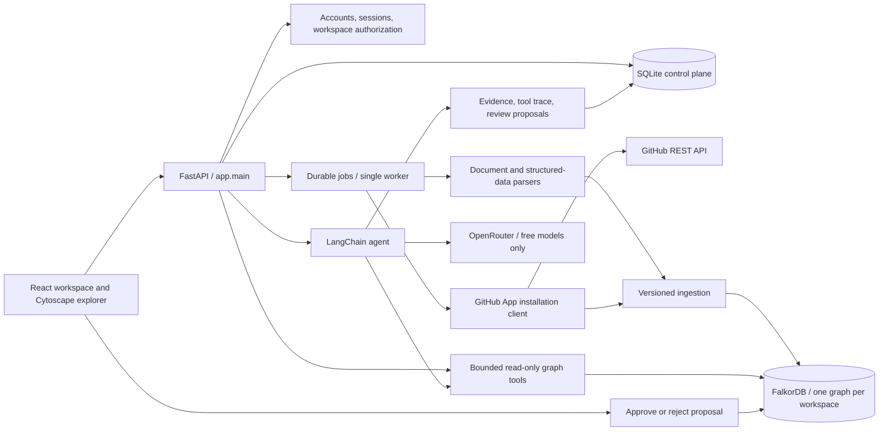

# DecisionTrail architecture

Updated October 17, 2026. This document describes the local product in `app/main.py` and `frontend/`. The earlier `app/api.py` and Atlas graph code are isolated prototype/regression artifacts; they are not the product entry point.

## Runtime architecture



## Components and ownership

| Component | Responsibility |
| --- | --- |
| `app/main.py` | Product API, account setup/sign-in, authorization, upload, admin, connector and review routes; serves built frontend |
| `app/control.py` | SQLite schema, encrypted secrets, audit events, durable source/job/run metadata |
| `app/knowledge.py` | All company graph operations, versioned passages, entity/relationship writes, explorer, search, bounded traversal, read-only Cypher |
| `app/ingestion.py` | File parsing, chunking, CSV/JSON projection, optional exact-evidence AI extraction |
| `app/jobs.py` | Single processing worker, persisted progress/errors, restart recovery and retries |
| `app/github_app.py` | Manifest registration, session-bound state, app JWTs and installation tokens |
| `app/connectors.py` | GitHub REST imports, structural repository/issue/PR/person graph; local CLI identity helper |
| `app/workspace_agent.py` | Model-selected fixed tools, fallback retrieval, citations, run history, proposed review tasks |
| `app/openrouter_model.py` | LangChain chat model backed by a bounded HTTP request to OpenRouter; rejects paid model IDs |
| `frontend/src/` | Auth, dashboard, source library, connector controls, graph explorer, agent workbench, review queue and admin UI |

## Storage boundaries

**FalkorDB owns company relationships and agent retrieval.** Every workspace has an application-generated graph name. The API selects it only after checking the signed-in user's access to the workspace. The legacy default `decisiontrail` fixture graph is separate.

**SQLite owns the control plane:** users, session hashes, workspaces, source content/metadata, jobs, connector references, agent definitions, runs, review proposals and audit records. Company answers are retrieved from graph passages and paths, not from a hidden fixture or a separate relational knowledge model.

**Local files:** `.data/workspace.sqlite3`, `.data/encryption.key`, and `.data/uploads/` hold persisted local state. Connector secrets use Fernet encryption; the encryption key must be included in a private backup, never in the repository. A hosted deployment needs a proper managed secret store/key policy.

## Knowledge graph schema

```text
(Workspace)
(Document {id, name, kind, uri, current_hash, updated_at})
  -[:HAS_VERSION]->
(DocumentVersion {id, hash, recorded_at, active})
  -[:HAS_CHUNK]->
(Chunk {id, text, position, source_id})

(Entity:Person|Project|Repository|File|Issue|PullRequest|Record|Concept|Task ...)
  -[:MENTIONED_IN]->(Chunk)

(Entity)-[:RELATED_TO {
  id, predicate, source_id, version_id, quote, active
}]->(Entity)

(Entity:Task {status, reason, approved_by})-[:SUPPORTED_BY]->(Document)
```

IDs are stable; document versions are content-addressed. A changed source deactivates earlier versions and its old semantic relationships; old passages and provenance remain inspectable. Re-uploading identical content does not create a new version. Archive removes a source from current retrieval while retaining history. Generic entity labels are sanitized before they enter a query; all values are parameterized.

## Ingestion flows

### Files and pasted text

1. The authenticated user selects a workspace and uploads a supported file or pastes text.
2. The API validates extension/size, stores bytes under a generated local filename, and persists a queued job.
3. The worker parses readable text, creates overlapping passages, and writes Document → Version → Chunk provenance to FalkorDB.
4. Structured records create entities deterministically. Explicit JSON nodes/edges preserve declared entity IDs and relationship types.
5. Source metadata is upserted, and the job reports completion, counts, or an error. Stable IDs allow safe retries.
6. AI enrichment is a separate user action. It sends up to a selected passage budget to the free model and accepts only relationships whose evidence quote exactly occurs in the passage.

Current limits: 10 MB/file, 500,000 extracted characters, 300 PDF pages, 2,000 structured records/nodes and 4,000 declared edges. The default AI budget is 6 passages, API maximum 30. These are explicit bounds; the product does not claim unlimited or complete semantic extraction. Scanned PDFs need OCR beforehand.

### GitHub App

1. Administrator starts manifest registration. GitHub asks the owner to create the app.
2. A session-bound callback exchanges the one-time code for App ID, slug, and RSA private key; secrets are encrypted locally.
3. User installs the app and chooses repository access in GitHub. The setup callback verifies state and reads the installation from the App API.
4. Repository reads mint a short-lived RS256 app JWT, then exchange it for an installation access token with read-only metadata, contents, issues and pull requests.
5. The token is used in memory and not persisted. A new token is minted when another sync/list request needs one.
6. Sync ingests overview, documentation, issues and PRs plus their authors/assignees and repository membership. Content hashes avoid duplicate versions on re-sync.

The local manifest omits webhook configuration, which GitHub accepts for an app without webhooks. Webhook delivery and automatic scheduled sync are not implemented. Manual sync has a visible 1–100 item/category limit. The local manifest creates an owner-only private app; multi-customer installations need a separate hosted design review.

GitHub CLI sign-in verifies the already authorized `github.com` identity and creates/logs into a local account. Its token is not saved as the source connector credential. Disable this local sign-in option with `ALLOW_GH_CLI_AUTH=false` before hosting.

## Agent execution

Agent definitions contain a name and editable task instructions. Each run is scoped to one authorized workspace.

1. An optional free model selects at most two calls from `search_sources(query)`, `entity_search(query)`, `expand_entity(entity_id)`, and `source_history(source_id)`.
2. Tool arguments and tool names are validated; identifier-based calls must use an ID already returned by a tool. Agents never receive a general Cypher write tool.
3. Search retrieves current graph passages. Expansion follows up to three hops of active, source-backed relationships.
4. Missing/invalid model output falls back to graph retrieval. No hidden Atlas data is substituted.
5. An optional generated answer must cite returned source IDs. This is a citation check, not a proof of every generated sentence; passages and tool paths remain visible for review.
6. Valid source-backed review-task proposals are stored. Approval creates a Task node linked to the source and records an audit event. External services are not modified by this action.
7. Question, answer, evidence, trace, model status and proposal references persist as a run.

OpenRouter accepts only `openrouter/free` or IDs ending `:free`. Free-provider outages/rate limits are expected operational states and shown as fallback results. LangChain fake models exercise planning and action behavior in tests without network requests.

## Analysis endpoints

- `GET /sources/{id}/diff` reconstructs a historical version from its overlapping passages and returns a bounded unified diff against the current version.
- `GET /sources/{id}/changes` compares relationships written by earlier versions of a source (now inactive) with those of the current version.
- `GET /analysis/conflicts` groups active `RELATED_TO` relationships by subject and predicate and returns groups whose targets differ across at least two sources, with quotes. Cardinality is unknown, so results are review candidates.
- `GET /graph/impact` traverses dependency-type predicates toward the selected entity; it never writes to the graph.
- `GET/PATCH /tasks` list tasks and update status (`open`, `in_progress`, `done`) with an audit event.

All are scoped to the authorized workspace; a source or task from another workspace returns 404.

## Explorer and query contract

- Cytoscape renders actual returned nodes and relationships, with pan/zoom, inspector, neighbor expansion and label/search filters.
- Node pagination loads 300 at a time; previously visible node IDs allow cross-page edges to be returned.
- The Cypher console uses FalkorDB's read-only command with a 2 second query timeout. Returned nodes/edges can replace the displayed graph with a query subgraph.
- Query transport returns at most 500 rows; graph responses cap edges. This is an exploration interface, not an unbounded analytics export service.

## Authorization and local operation

- Passwords use salted PBKDF2; session tokens are random and stored as hashes; cookies are HttpOnly and SameSite=Lax.
- Workspace checks precede graph selection, uploads, runs and reviews. Admin routes reject member accounts.
- Mutating browser requests check the request Origin. Configure `APP_ORIGIN` for any new host.
- File content is data. Model prompts identify source text as untrusted input and the model has only read tools.
- No API response returns private keys or connector tokens. `.env`, `.data`, `.venv`, uploads, and frontend build output are gitignored.
- Hosted delivery is deferred. HTTPS, secure cookies, managed secrets, rate limits, operational backups, hosted sign-in, and tenant-specific installation ownership require completion before a public SaaS launch.

## Verification and remaining work

Meaningful tests exercise source versions, active retrieval, graph write rejection, account isolation, secret redaction, app states/JWTs, temporary token handling, LangChain planning and reviewed tasks. Live installation and repository sync have been exercised through GitHub, not only mocks.

Still pending: automatic sync and deletion reconciliation, large-scale search indexing, counterfactual analysis beyond the read-only impact preview, text-only contradiction detection, a recorded demo, and hosted delivery. See [plan.md](plan.md) for delivery status.

## References

- [GitHub App manifest](https://docs.github.com/en/apps/sharing-github-apps/registering-a-github-app-from-a-manifest)
- [Installation authentication](https://docs.github.com/en/apps/creating-github-apps/authenticating-with-a-github-app/authenticating-as-a-github-app-installation)
- [Repository contents API](https://docs.github.com/en/rest/repos/contents)
- [Cytoscape.js](https://js.cytoscape.org/)
- [FalkorDB documentation](https://docs.falkordb.com/)
